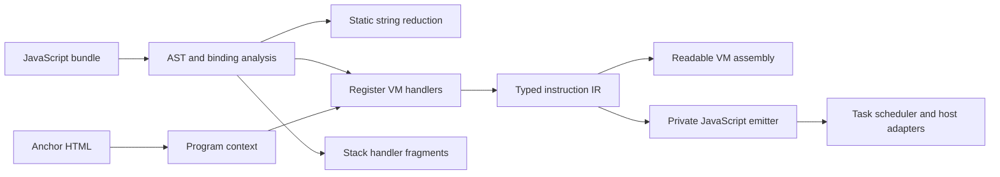

# RecaptchaV3 - Technical Deep Dive

## Scope and evidence

The working study began with one supplied JavaScript bundle and its associated
anchor HTML. It later examined German and English assets belonging to the same
release and controlled local runtime fixtures. Those assets do not provide an
independent release holdout. Renaming a fixture also does not establish support for
a future production version.

This edition preserves the analysis methods, full recovered listings and selected offline implementation. Captured
assets, their exact identities, runtime parameters and operational source positions
are withheld. [REDACTED: original samples, sample hashes and private evidence links].
Public fixtures have separate [authored provenance](examples/register/PROVENANCE.md)
and are the only profile accepted by the distributed decoder. The separate full research listings retain recovered instructions with marked redactions.

Evidence is described at four levels:

| Level | Meaning | What it does not prove |
| --- | --- | --- |
| Source recovery | A handler or producer was selected from an AST and examined | That it executed in the observed browser session |
| Decoding | Boundaries, operands and targets were recovered | That every target was reached |
| Execution | A controlled case traversed a path | That all inputs and environments behave the same |
| Behavioral comparison | Observed return values, errors and state effects agreed | Complete path coverage or release independence |

Private measurements below are reported observations. Their original artifacts are
withheld, so readers cannot independently reproduce them from this edition. Public
verification results are recorded separately in [Validation](docs/VALIDATION.md).

## Architecture

The supplied anchor payload belongs to the register family. It does not establish
another VM. The separate Botguard loader depends on data absent in that HTML.
Ordinary switches, large function tables and numeric selector branches were excluded
from the VM count unless instruction consumption and state transitions could be shown.
No register-to-stack execution transition has been established.

## Register family

The interpreter consumes an instruction header, selects a handler and reads typed
operands from a byte stream. Its working state combines a cursor, register bank,
handler configuration, callbacks and suspended tasks. Several numeric slots share
the same semantic operation. Opcode numbers belong to a particular configuration;
the common representation names behavior instead.

The decoder records byte ranges, raw encoding, operand read modes, handler evidence,
targets, potential function entries and explicit unknown regions. It refuses
unqualified profiles and unexpected layouts. Unknown data is never treated as NOP.
The [specification](vms/vm_02/Full_Reverse.md) explains the retained implementation.

One captured initializer in the private study decoded to 279 instructions. Two
controlled locally generated main programs decoded to 5,272 and 5,897 instructions.
A later localized live main stream decoded to 5,904 instructions. These are distinct
provenance classes: captured input, locally generated runtime fixture, and live
observation. They are not bundled here.

The private working Go emitter lowers instructions into callable JavaScript functions and
retains a cursor-driven state machine. It preserves explicit reads and side effects
instead of inventing source-level functions or loops. Authored JavaScript support
implements language behavior that cannot be replaced with ordinary Go arithmetic.
This is a low-level decompiler, not recovered original application source.

## Scheduler

Work records capture an entry cursor, argument bank slot, priority, deadline,
expiry and completion/error callbacks. A slice swaps register banks, resumes a
cursor, executes a bounded amount of work and records timing. Yield and instruction
budget exhaustion preserve continuations. Closures enqueue work through an explicit
adapter; they do not recursively execute a reconstructed browser application.

Clocks, idle callbacks, deferred callbacks, hidden-document checks and loaders are
injected. Queue promotion, timer return values and callback order can affect behavior.
The [scheduler report](vms/vm_02/SCHEDULER.md) names those boundaries. Browser form,
media and reentrant load paths remain incompletely covered.

## Stack family

The private source inventory selected 77 handler registrations containing 121 IDs.
The study independently compared 38 core operation kinds. Arithmetic, coercion,
stack consumption, frame helpers and encrypted immediate readers provide evidence
of stack-oriented fragments. They do not supply the missing consuming interpreter.

The original also contains literal null call and constructor paths. Their behavior
cannot be repaired by guessing a missing callee. A complete stack bytecode program,
dispatch convention and owner state have not been recovered. This edition retains
a catalogue renderer that prints this unresolved boundary. See the
[stack report](vms/vm_01/Full_Reverse.md).

## Nonvirtualized logic and runtime flow

Ordinary JavaScript coordinates message initialization, script loading, event
registration, task building, result encoding and serialization. Static string
factories are separate from VM dispatch. Their closures can memoize results, so a
valid string value alone is insufficient to justify replacing every call.

The private local runtime builder composes 25 providers with allocation, initialization,
collection and helper phases. Broad signal categories include intrinsic inspection,
environment APIs, document/form context, input event history and timing. They flow
through VM callbacks and ordinary JavaScript wrappers before serialization.
[REDACTED: precise provider-to-slot bindings, source entry points and fingerprint values].

Program transport and result encoding are separate layers. Reversing the outer
container can still leave nested encoded values. UTF-16 masking can discard high
bits; string coercion can discard object structure. A roundtrip proves only the
information preserved by that layer. The [flow report](docs/FLOW.md) records these
distinctions without exposing replay material.

## Dynamic extraction

The working pipeline separates structural discovery, profile reconstruction,
byte decoding, semantic normalization and output. It uses lexical bindings and
AST dataflow rather than requiring stable minified names. Context provenance,
assignment order, aliases, numeric selectors and conditional writes all matter.
When source alone lacks a runtime value, an extractor must request that context
and name the missing field. It must not fabricate a key or silently pick a candidate.

[REDACTED: production context extraction, release bindings, keys and seeds]. The
public decoder accepts only its authored fixture identity. Its numeric opcode
configuration remains separate from common semantic layouts, which demonstrates
the design without shipping a live extraction recipe.

Synthetic tests vary names, closure structure, opcode assignments and malformed
inputs. No supported-future-version claim follows from these tests. A genuine
independent-release comparison remains open.

## Measurements and remaining work

The private working-tree check recorded 110 top-level Go tests, 155 tests including
subtests, and 193 JavaScript tests passing at its frozen checkpoint. Those counts
belong to the larger private tree, not this publication subset. Original scheduler
comparisons covered 21 controlled cases. One local main fixture reached 2,763 of
5,272 unique positions; the second reached 2,574 of 5,897. Successful decoding and
partial execution do not close the remaining paths.

The full-source function atlas contains 3,482 function ranges; 216 purposes had been
reviewed. A claim that every original function is explained would be false. This
edition's [function guide](docs/FUNCTIONS.md) covers the retained tools and runtime
entry points, and identifies the unreviewed original program scope.

Outstanding requirements are an independently qualified live reader/profile,
remaining browser and scheduler paths, missing runtime bank inputs, a proven stack
consumer/program, further Go ports and a real release holdout. Redacted material
adds a separate publication limit; it does not turn unresolved research into a
completed result.

## Published listings

The [assembly guide](docs/ASSEMBLY.md) documents all 11,451 recovered register instructions and all 77 stack handler records. Sensitive values and operational mappings are censored; the decompiler and executable runtime are withheld.
