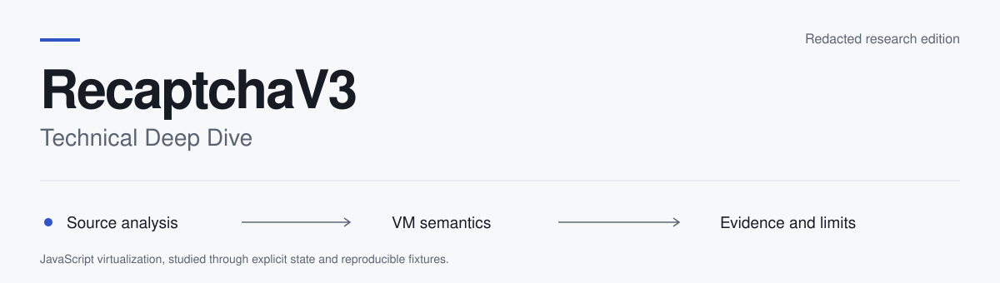

<picture>
  <source media="(prefers-color-scheme: dark)" srcset="assets/header-dark.svg">
  
</picture>

# RecaptchaV3 - Technical Deep Dive

A study of JavaScript virtualization, cooperative scheduling and encoded browser
signals in a supplied reCAPTCHA v3 sample. This redacted research edition contains
the full recovered ASM listings, technical reports and offline Go analysis tools.
Decompiler and executable runtime code remain private.

**Status: partial reverse engineering · full recovered listings with redactions.**
Every recovered instruction is retained. The original stack program, some runtime
paths and most original function purposes remain unresolved.

[Read the analysis](Full_Reverse.md) · [Read the ASM](docs/ASSEMBLY.md) ·
[Run the tools](docs/TOOLS.md) · [See the redactions](docs/REDACTIONS.md)

## Findings

| Component | Evidence | Publication |
| --- | --- | --- |
| [vm_02](vms/vm_02/Full_Reverse.md) | Register interpreter; 42 bindings normalize to 32 operations in the examined profile | [11,451 recovered instructions](output/vm_02_output.asm) across six distinct streams and one alias, with sensitive data censored |
| [vm_01](vms/vm_01/Full_Reverse.md) | Stack-oriented fragments; 77 handler records expose 121 registration IDs | [All 77 handler records](output/vm_01_output.asm); IDs and original source locators censored; consuming dispatcher unresolved |
| [Botguard loader](vms/vm_botguard/README.md) | Separate component; required loader data absent in the supplied HTML | Scope note only |

One ASM file per evidenced family. Public listing addresses and registers are local
aliases; they preserve control/data relationships while withholding production
locations. `[REDACTED:S…]` and `?N…` mark censored values. These listings are research
artifacts with missing values, not runnable or reassemblable programs.

## Start reading

1. [Full analysis](Full_Reverse.md): architecture, evidence classes and open work.
2. [Assembly guide](docs/ASSEMBLY.md): all recovered streams, notation and verification.
3. [Register specification](vms/vm_02/Full_Reverse.md) and [scheduler](vms/vm_02/SCHEDULER.md).
4. [Flow and fingerprint model](docs/FLOW.md): layers, provider categories and information loss.
5. [Function guide](docs/FUNCTIONS.md): retained tools and private runtime responsibilities.
6. [Validation](docs/VALIDATION.md) and [redaction ledger](docs/REDACTIONS.md).

## Offline tools

Use Go 1.25.3 or a compatible newer toolchain. Dependency installation can contact
the module proxy; analysis commands do not use a browser or network connection.

```sh
go test ./...
go vet ./...
go run ./cmd/check
go run ./cmd/research decode --configuration examples/register/configuration.json --input examples/register/program.bin --out .work/register
```

The public tool accepts an authored synthetic profile, not a production binding
table. Its examples are separate from the redacted research listings. No decompiler,
live collector, fingerprint capture or token submission command is distributed.
See [Tools](docs/TOOLS.md) for static string reduction, AST inventory and limitations.

## Publication boundary

Keys, seeds, production binding tables, exact source entry points, live payloads and
raw fingerprints are [REDACTED: operational material]. Generic semantic operations,
all recovered instruction/handler records and the report's unresolved findings remain
visible. The first commit contains only this redacted edition.

This is independent research, unaffiliated with Google. Names identify the systems
being studied. [Rights and attribution](docs/RIGHTS.md) records project licensing
status and dependency notices.
