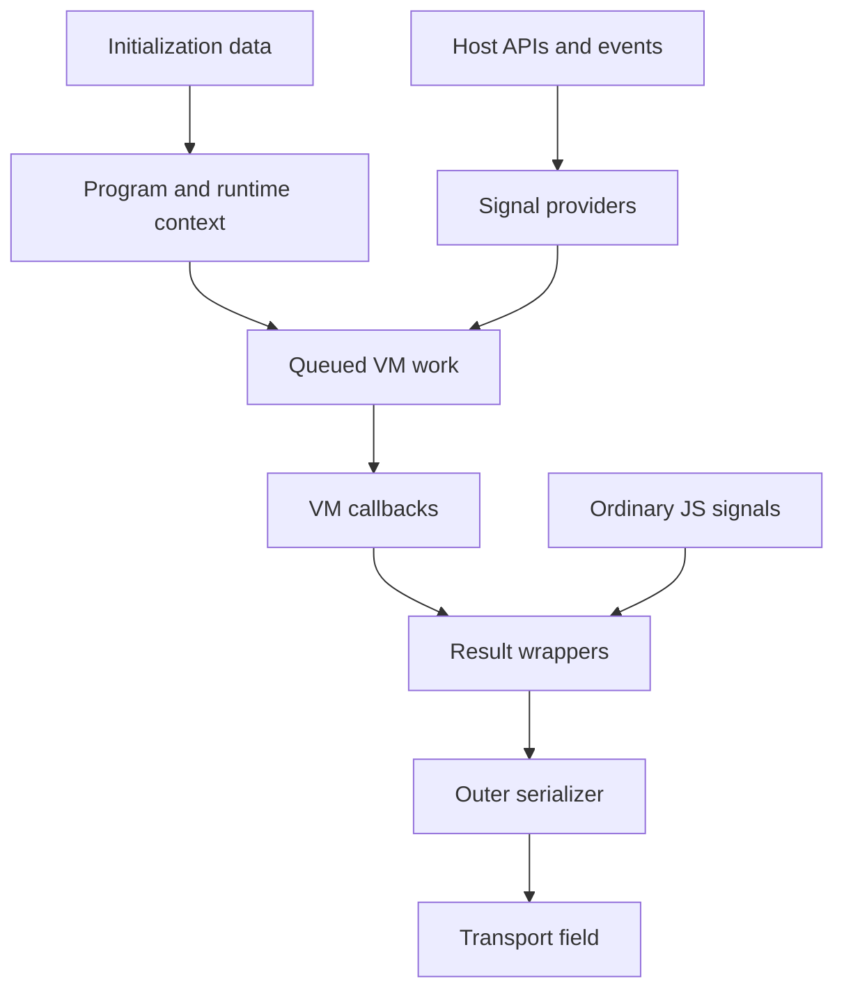

# Runtime flow and fingerprint model

The working study follows data from initialization through providers, queued VM
work, callbacks, result wrappers and an outer serializer. Captured request material
and source locations are withheld in this edition. This report describes boundaries
and information properties rather than a replay procedure.

## Program transport

Program text has a context-dependent masking layer and an encoded byte container.
Its keys and numeric parameters must be derived from the correct source/runtime
context. A constant extracted from the wrong initializer can decode plausible bytes
while describing a different program. The study therefore tied source witnesses,
context bindings and decoded byte hashes together before accepting a result.

[REDACTED: key composition, parameters, precise context fields and extraction routes].
The public register example starts with authored clear bytecode and does not contain
an encrypted live program.

## Results and information loss

Two result codecs were examined in the working study. Their numeric operations use
JavaScript Number behavior, signed remainder and UTF-16 units. A native port must
preserve those operations; substituting a wider integer PRNG can change output.
[REDACTED: codec parameters, wire bindings and runnable production codecs].

One path retains only low byte residues from UTF-16 values. Once high bits have been
discarded, no decoder can recover them from that payload alone. A separate string
coercion can replace an object with a textual representation, also losing structure.
The outer serializer's exact text is consequently different from a structured,
pre-coercion fingerprint snapshot. A successful encode/decode roundtrip checks that
layer's retained bytes, not the absent original information.

## Fingerprint categories

| Category | What a value can describe | Interpretation limit |
| --- | --- | --- |
| Intrinsic inspection | Properties and behavior of selected built-ins | Environment and instrumentation can affect results |
| Environment APIs | Availability and outputs of storage, graphics, battery or related interfaces | An unavailable API is not evidence of one device identity |
| Document/form context | Properties of the current document and relevant controls | Page content and timing change values |
| Event history | Observed focus, pointer, keyboard and supplied media events | Recorded history is partial and context-dependent |
| Timing | Clock deltas, scheduling work and elapsed measurements | Controlled fixture clocks do not represent field distributions |
| VM callbacks | Provider outputs wrapped by the execution system | Null/missing callbacks need their own interpretation |

[REDACTED: raw fingerprint, exact slot dictionary, algorithm-to-field bindings and
device-specific observations]. A complete public fingerprint mapping is not claimed.
The detailed private mapping cannot be reconstructed from this category table.

## Validation boundaries

The private capture used a fresh browser profile and instrumentation. It did not
establish equivalence with an untouched browser. Function wrappers, clocks and
environment fixtures can influence introspection and scheduling. Most providers
were catalogued by source and controlled execution; full browser path coverage
remains open.

Transport headers, cookies, response tokens and submission endpoints are omitted.
No score, bypass rate or token validity claim is made by the public examples.
